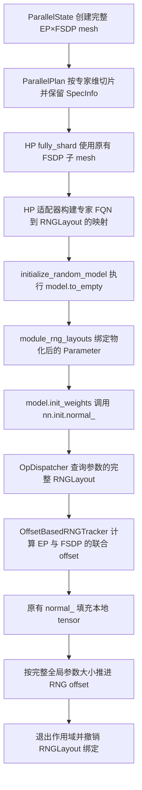

# EP 与 FSDP 组合下的随机初始化

本修复保留原有 `nn.init.normal_` 与 `OffsetBasedRNGTracker`，为提前完成 EP 切片的专家参数补充完整随机数布局。参数的运行布局、存储、梯度归约和 checkpoint 描述均保持原有语义。

## 问题来自两处布局截断

VeOmni 的 `parallel_state.init_ep_mesh_matrix()` 已创建完整的 EP×FSDP mesh。`ParallelPlan.apply()` 随后沿专家维执行 `Shard(0)`，再通过 `to_local()` 将结果装回普通 Parameter。HP FSDP 接收这些已经切好的专家，并用仅含 `ep_fsdp` 的子 mesh 沿参数维 1 分片。

这个运行布局适用于训练：专家之间通过 EP 交换 token，同一个专家内部通过 FSDP 恢复和归约参数。但是，随机初始化如果只读取这个 FSDP 子 mesh，就看不到参数在全局专家集合中的位置。

此前又在 `initialize_random_model()` 中使用了 `SkipDTensorDispatch`，导致 `normal_` 连 FSDP 随机数分发也绕过。所有 rank 同种子、同本地形状和同 RNG 状态，使 FSDP16 的 router 每 8 行重复。去掉 Skip 后，router 恢复独立；EP16/FSDP1 的专家仍重复，因为 RNG 看到的是每 rank 8 个专家和坐标为 0 的 FSDP1。

## 修复后的调用链



具体实现位置：

|环节|位置|作用|
|---|---|---|
|完整 EP mesh|VeOmni `veomni/distributed/parallel_state.py` 的 `init_ep_mesh_matrix()`、`expert_dtensor_placements`|定义 EP、FSDP 与数据副本的归属关系|
|EP 切片|VeOmni `veomni/distributed/parallel_plan.py:ParallelPlan.apply()`|切出本 rank 专家，并保存 `SpecInfo`|
|初始化适配|VeOmni `veomni/distributed/hp_fsdp2.py` 的无 checkpoint 初始化分支|复用 `hp_expert_mesh`，恢复专家维全局 shape，提供 `[Shard(0), Shard(1)]`；有副本时补 `Replicate()`|
|参数绑定|[random_init.py](../../../hyper_parallel/core/dtensor/random_init.py)|`RNGLayout` 保存随机数布局；`module_rng_layouts()` 以当前 Parameter 身份绑定并校验本地形状|
|随机分发|[_op_dispatch.py](../../../hyper_parallel/core/shard/_op_dispatch.py)|`_dispatch_random_op()` 优先读取作用域内布局，否则使用原有 DTensor 布局|
|offset 算法|[random.py](../../../hyper_parallel/core/dtensor/random.py)|复用 `_distribute_region()`、`compute_offset_incr()` 与 `_set_post_op_offset()`|

适配器传入的 `init_context` 现在是 `module_rng_layouts` 元数据作用域。它不会设置 DTensor dispatch disabled，不改变随机算子本身，也没有引入另一套 RNG 或 `seed + global_rank` 规则。

## 为什么必须在 to_empty 之后绑定

`model.to_empty()` 可能替换 Parameter 对象，因此适配器先保存 **FQN→RNGLayout**，在 `model.to_empty()` 完成后才进入 `module_rng_layouts()`。作用域此时通过 FQN 找到实际 Parameter，并将其身份关联到完整布局。

每个布局还会验证：按照完整 mesh、placements 和当前 rank 坐标推导出的本地形状，与现有参数的本地存储形状完全一致。不能为本地 tensor 任意指定一个不匹配的全局 shape。

退出作用域时通过 `ContextVar.reset()` 恢复先前绑定，异常路径和嵌套作用域也会恢复。没有将初始化专用的 EP 全局 shape 写回参数的运行布局。

## EP16/FSDP1 的具体 offset

以本次 gate/up 权重为例：

```text
完整 shape       = [128, 2816, 4096]
完整 mesh        = [EP16, FSDP1]
placements       = [Shard(0), Shard(1)]
每 rank 本地形状 = [8, 2816, 4096]
每 rank 元素数   = 92,274,688
```

设算子前的公共 offset 为 B，当前 tracker 按 shard linear index 与本地元素数计算偏移，并按 4 对齐：

|EP rank|本次 normal_ 的起始 offset|
|---|---:|
|0|B|
|1|B + 92,274,688|
|2|B + 184,549,376|
|15|B + 1,384,120,320|

算子结束后，所有 rank 按完整参数的 `128×2816×4096 = 1,476,395,008` 个元素统一推进状态，得到 `B + 1,476,395,008`。这些数字是当前 tracker 的 offset 计算值，不是参数的字节数。

因此不同 EP 专家使用不同随机数区间；同一专家参数的 FSDP 分片也使用不同区间。`Replicate()` 不增加 shard linear index，同一专家分片的数据副本使用相同区间，保持一致。

本修复没有更改 tracker 既有的 shard-linear-offset 算法。不同 EP/FSDP 划分之间是否逐元素匹配单卡初始化，不属于本次验证结论；本轮比较要求在相同布局下初始化可复现、各逻辑分片独立、实际副本一致。

## 训练通信 mesh 与初始化 mesh 的区别

完整 `hp_expert_mesh` 在修复前已经创建。交给专家 `fully_shard()` 的始终是
`hp_expert_mesh[parallel_state.expert_fsdp_mesh.mesh_dim_names]`：固定本 rank 的 EP 坐标，
只保留 `ep_fsdp`，有数据副本时再保留 `ep_replicate`。
`expert_fsdp_kwargs["mesh"]` 的传参不变。
HP 的 `FSDPMeshInfo` 从这个子 mesh 的 shard 维取得 `shard_process_group`，
后续 all-gather / reduce-scatter 使用该组。EP 的 token 交换则使用另一条 EP 通信域。

以 world16、`ep_outside=False`、没有数据副本为例：

|配置|专家 EP 通信域|专家 FSDP 通信域|非专家 FSDP 通信域|
|---|---|---|---|
|EP2 / 专家 FSDP8|`[0,1]`、`[2,3]` 等 8 组|偶数 rank 一组、奇数 rank 一组；每组持有相同 64 个专家的不同参数分片|全部 16 rank|
|EP16 / 专家 FSDP1|全部 16 rank|每个 rank 单独一组；各持有 8 个完整专家|全部 16 rank|

本次只在随机算子的 `_distribute_region()` 中使用完整 mesh、完整 shape 和完整 placements
计算 RNG offset。它不会修改 DTensor 的运行 mesh、FSDP 通信组、参数分片或梯度通信 dtype。

因此精度验证分为两件事：训练通信语义保持不变；初始化数值有意改变，消除原有的重复权重。
修复前后的同种子不代表相同初始模型，不能要求训练曲线逐值一致。
正确的对照是从修复后的同一布局、同一种子出发，让普通 EP、非融合 MoonEP 和 native MoonEP
使用相同初值与输入，再比较 loss/norm、梯度和优化器更新。

## 已完成的验证

相关 CPU 单测合计 **77 项通过**，包括作用域撤销、异常与嵌套恢复、第二个参数绑定、运行参数身份保持、完整布局进入 dispatcher、EP16 offset 以及副本 offset 一致性。测试位于 [test_random_init.py](../../../tests/ut/core/dtensor/test_random_init.py)。

真实 16 rank 构造检查同时覆盖 student 和 teacher：

|布局|专家完整本地分片 SHA256 检查|Router 检查|
|---|---|---|
|EP16/FSDP1|每个专家权重矩阵的 128 个完整专家 hash 均不同|128 行独立；std 约 0.0200；不再每 8 行重复|
|EP2/FSDP8|128 专家×8 个 FSDP 分片，共 1024 个本地完整分片 hash 均不同|128 行独立|
|EP4/FSDP2/数据副本2|256 个不同专家分片；每份出现两次，对应副本逐字节相同|两个副本组恢复出的完整 router 一致|

以上使用完整本地专家分片的 SHA256，不仅检查前几个元素。EP16/FSDP1 的本地专家就是完整逻辑专家；带 FSDP 的两组 hash 对应完整的本地专家分片。

所有构造检查退出后，DTensor dispatch 均保持开启，参数上的初始化 RNG 绑定均已撤销。构造检查不计为训练性能结果。初始化改变后的性能和 loss/norm 比较，应使用同一修复版本、同一布局和同一初始种子的全新基线。
